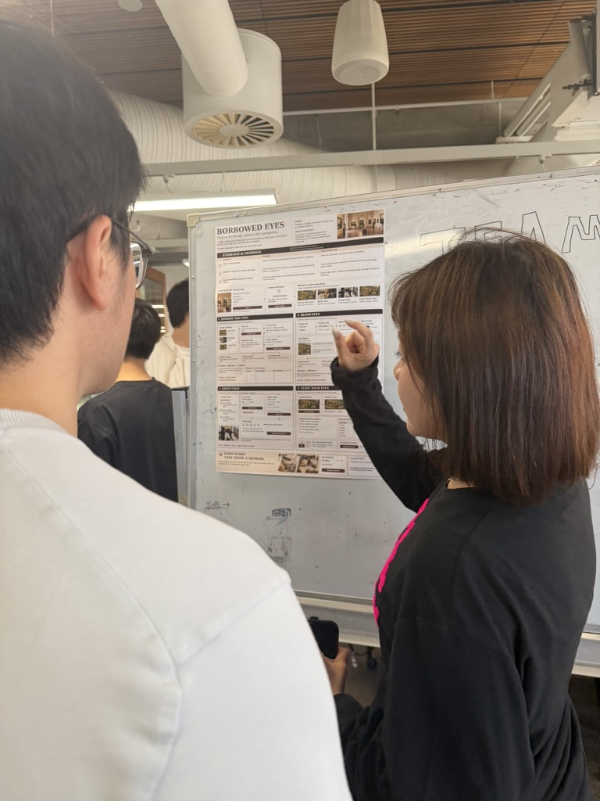
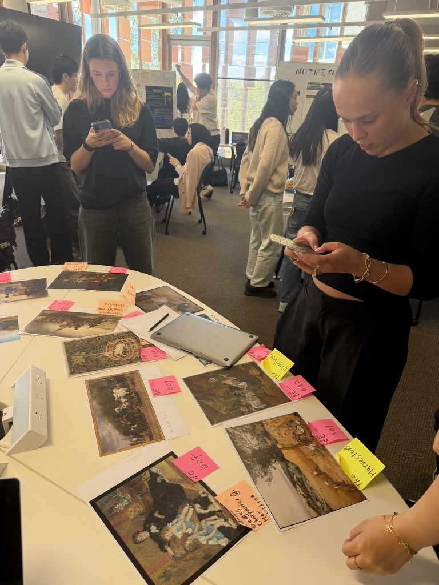

# Tradeshow demonstration and pitch

The team confirmed completion of the tradeshow demonstration and short pitch. Two photographs supplied by the team document the exhibition setting. The event date and a verbatim pitch script are not established by these photographs.

## Poster discussion

The photograph shows a presenter explaining the Borrowed Eyes poster to a visitor. It supports the record of a poster discussion, without establishing the exact words or duration of the pitch.

## Phone interaction beside physical artwork materials

The photograph shows visitors using phones beside printed artwork reproductions and labels. It documents the physical demonstration context. Screen content is not readable, so the photograph alone cannot verify matching, task completion or user satisfaction.

## Online functionality check

Separately, the team confirmed that two phones scanned the QR code, opened the online prototype, matched successfully and displayed the partner. Iris completed and refined the backend. This team-confirmed functionality check should be distinguished from the earlier four Blind Eyes formative rounds and one Face-to-Face session on 14 October 2026.

No new satisfaction scores, success rates, participant quotes or usability findings are inferred from the photographs. See the [evaluation results](../Evaluation/Round_3/Testing_Results.md) for the actual study evidence, the [prototype guide](../../Prototype/README.md) for operation, and the [poster](poster.png).
